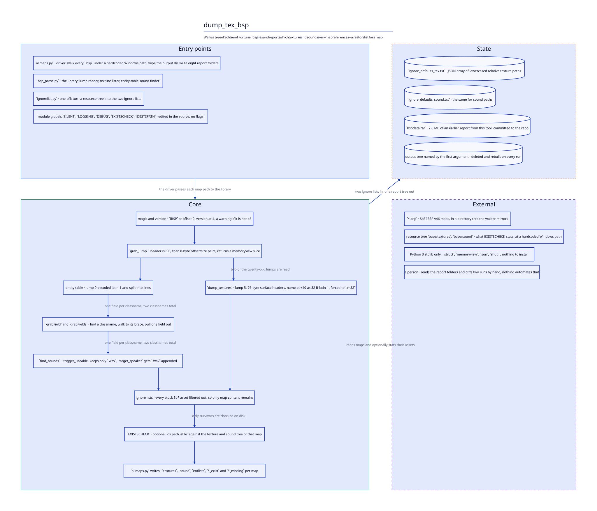

# dump_tex_bsp

A report generator for Soldier of Fortune map archives: it opens every `.bsp`, reads the texture list and the entity table, and writes out which textures and sounds each map references — the list you need to restore an FTP that lost its assets.

Read it left to right:

- **It reads two lumps out of twenty-odd.** `grab_lump` is written generically against the 8-byte lump table, but only lump 0 (the entity text) and lump 5 (the surface list) are ever asked for. Geometry, lightmaps, visibility and the rest are ignored — this is an asset reference lister, not a map parser, and a texture only appears because it is on a surface.
- **Every texture is renamed to `.m32` on the way out.** The name is 32 bytes at offset +40 of a 76-byte surface header, latin-1, lowercased, then `os.path.splitext(name)[0] + ".m32"` — whatever extension the map stored is discarded. On the plus side that makes a `.jpg` reference and a `.m32` reference compare equal in the report; the recent "allow .m32 texture names" commit is exactly this line growing up.
- **Entities are parsed by splitting on quotes, not tokenized.** A line whose quote count is even is skipped as malformed, and the remaining fields are filtered with `" " not in s`, so a sound path containing a space disappears without a warning. Braces are located by scanning outward from the classname, which means the table has to be well-formed *and* ordered — an unbalanced entity silently aborts the whole map. The `grabFields` "efficiency" skip records the opening brace, which is always behind the cursor, so it never actually skips anything.
- **Only two classname/field pairs are considered sounds.** `trigger_useable`/`targetname` must already end in `.wav` or the value is dropped as a broken map field; `target_speaker`/`noise` gets `.wav` appended. Everything else that carries a sound name — doors, trains, `ambient_set`, `music_set`, `worldspawn` — is documented in `sound_research.txt` and not read, so those sounds are missing from every report.
- **The ignore lists are what make the output usable.** `ignorelist.py` walks a stock SoF install and dumps every relative path, lowercased, into two JSON arrays; a texture or sound in those arrays is filtered out, so the report only names assets the map itself ships. That also pins the lists to one exact install layout, `EXISTSCHECK` is off by default (nothing verifies a file is really there), and `allmaps.py` both hardcodes a Windows FTP path and `rmtree`s whatever directory you pass as its first argument.

Diagram source: [`docs/system.d2`](docs/system.d2) · renderer: [`scripts/render-diagram.sh`](scripts/render-diagram.sh).
